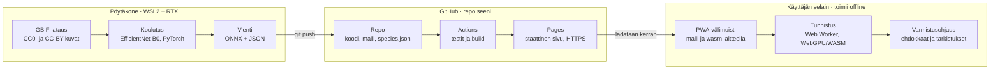

# seeni.fi – projektiohje alusta loppuun

Päivitetty 18.10.2026

## Yleiskuva

Koko ketju toimii ilman backendiä. Malli koulutetaan Windows-pöytäkoneen näytönohjaimella, viedään ONNX-tiedostoksi ja ajetaan käyttäjän selaimessa staattiselta GitHub Pages -sivulta. Sivu toimii myös offline.

- **Pöytäkone (WSL2 + RTX):** datan keruu, koulutus, arviointi ja vienti.
- **Mac:** kehitys etänä pöytäkoneelle SSH:n yli, sekä web-sovelluksen tekeminen agenttien kanssa.
- **GitHub:** koodi, lajitiedot, valmis malli, Actions-julkaisu ja Pages-hostaus osoitteessa `https://luukalindgren.github.io/seeni/`.



Pöytäkoneelta GitHubiin siirtyy vain valmis malli ja sen JSON-tiedostot. Käyttäjän selain lataa ne kerran ja tunnistaa sen jälkeen ilman verkkoa.

Vaiheet 1–8 tehdään pöytäkoneella, vaiheet 9–11 enimmäkseen Macilla. Suurin työ on datassa (vaihe 4) ja lajitietokannassa (vaihe 9), ei koulutuksessa.

## Vaihe 1: Pöytäkoneen valmistelu

Tavoite: pöytäkoneen WSL2-Ubuntussa näkyy näytönohjain PyTorchille, ja pääset koneelle Macilta SSH:lla mistä tahansa.

1. **NVIDIA-ajuri Windowsiin.** Päivitä ajuri Windows-puolelle. WSL:ään ei asenneta erillistä Linux-ajuria. Aja PowerShellissä `nvidia-smi`, niin näet onko kortti 2070 vai 3070.
2. **WSL2 ja Ubuntu.** `wsl --install -d Ubuntu-24.04`, sitten uudelleenkäynnistys.
3. **WSL-asetukset.** Tiedostoon `%UserProfile%\.wslconfig`:

   ```
   [wsl2]
   memory=24GB
   networkingMode=mirrored
   ```

   Säädä `memory` noin 3/4:aan koneen muistista. Ubuntun puolelle `/etc/wsl.conf`, jotta Tailscale ja sshd voivat käynnistyä palveluina:

   ```
   [boot]
   systemd=true
   ```
4. **Python ja PyTorch.** Asenna `uv` ja Python 3.12. Hae PyTorchin CUDA-asennuskomento pytorch.org-sivun valitsimesta. Tarkista: `python -c "import torch; print(torch.cuda.is_available(), torch.cuda.get_device_name())"`.
5. **Data WSL:n omalle levylle.** Pidä kuvat polussa `~/seeni-data`, ei `/mnt/c`:ssä. Windows-levyn kautta luku on moninkertaisesti hitaampaa ja hidastaa koulutusta.
6. **Etäkäyttö.** Asenna Tailscale Windowsiin ja Maciin samalla tilillä. Mirrored-tilassa WSL käyttää Windowsin verkkoa, joten Ubuntun sshd näkyy Windowsin Tailscale-osoitteessa.
   - Ubuntuun `openssh-server`, portiksi `2222`, vain avaimella kirjautuminen (`PasswordAuthentication no`).
   - Jos yhteys ei aukea, salli portti Windowsin palomuurissa.
   - Macin `~/.ssh/config`: `Host seeni-pc`, `HostName <Tailscale-nimi>`, `Port 2222`.
   - Zedin Remote Development toimii suoraan tällä hostilla.
7. **Pitkät ajot.** Aseta Windowsin lepotila pois päältä verkkovirralla. Aja koulutukset `tmux`-istunnossa, jolloin ne jatkuvat, vaikka SSH-yhteys katkeaisi. Asenna Claude Code WSL:ään, niin agentit ajavat komennot suoraan samassa ympäristössä.

## Vaihe 2: Repo ja projektirakenne

Yksi julkinen GitHub-repo `seeni`, jossa koulutus ja sivu ovat rinnakkain. Pages on ilmainen julkisille repoille.

```
seeni/
  CLAUDE.md          säännöt agenteille (esikäsittely, lajijärjestys, lisenssit)
  docs/PLAN.md       tämä ohje
  training/          Python (uv): data, koulutus, arviointi, vienti
  data-meta/         lajilista.csv, split.csv, attribuutiot (pieniä tiedostoja)
  species/           species.json, käsin kuratoitu lajitieto
  web/               Vite + TypeScript -sovellus
    public/models/v1/  model.onnx, labels.json, preprocess.json, calibration.json
  .github/workflows/pages.yml
```

- **Gitiin eivät mene** kuvat eivätkä checkpointit. Ne ovat polussa `~/seeni-data`, ja `.gitignore` estää niiden lisäämisen. Poikkeuksia ovat julkaistava malli (`web/public/models/`), kuvat kansioissa `web/`, `species/` ja `docs/` (ikonit, tarkistusten kuvat, kuvakaappaukset), testien kultaiset testikuvat (`tests/fixtures/`, vaihe 8) ja attribuutiodata (`data-meta/`). Muiden kuin omien kuvien pitää olla CC0- tai CC-BY-kuvia, ja niiden attribuutiot kirjataan `ATTRIBUTIONS.md`:hen.
- **Valmis ONNX-malli** (10–30 Mt) mahtuu gitiin hyvin, koska GitHubin raja on 100 Mt tiedostoa kohden. Versioi malli kansiolla (`v1`, `v2`), jotta selaimen välimuisti päivittyy.
- **CLAUDE.md** on tärkeä tiedosto, koska teet projektin agenteilla. Siihen on kirjattu sitovat säännöt, jotka eivät saa ajautua: esikäsittely on määritelty yhdessä tiedostossa, lajien järjestys tulee aina `labels.json`-tiedostosta, ja vain CC0/CC-BY-kuvia saa käyttää.

## Vaihe 3: Lajilista

Aloita 100–200 luokalla. Ne muodostuvat Ruokaviraston kauppasienistä, niiden myrkyllisistä kaksoisolennoista ja yleisimmistä sienistä, joita metsässä tulee vastaan.

1. Tee `data-meta/lajilista.csv`, jossa on yksi rivi taksonia kohden. Sarakkeet: `class_id`, tieteellinen nimi, suomenkielinen nimi, GBIF `taxonKey`, ryhmä (syötävä / esikäsiteltävä / myrkyllinen / tappava / ei ruokasieni), kaksoisolennot (luokkatunnisteina, puolipisteellä eroteltuina) ja `in_model` (true / false).
2. Hae `taxonKey` GBIF:n species match -rajapinnasta (`api.gbif.org/v1/species/match?name=…`) ja tarkista osumat käsin.
3. Hae suomenkieliset nimet laji.fi:n taksonomiasta.
4. **Yhdistä luokiksi lajit, joita ei erota kuvasta** (esim. useimmat seitikit), ja anna varmistusohjauksen hoitaa loput. Malli, joka sanoo rehellisesti "seitikki", on turvallisempi kuin malli, joka arvaa lajin.
5. Tavoite on vähintään noin 100 kuvaa luokkaa kohden. Jos kuvia jää vähemmän, yhdistä luokka toiseen tai jätä se pois ensimmäisestä versiosta.

**Luokan tunniste.** Jokaisella luokalla on pysyvä tekstitunniste `class_id`: pienet ASCII-kirjaimet ja väliviivat, yleensä tieteellinen nimi (`cantharellus-cibarius`, suvun tasolla `cortinarius`). Yhdistetyssä luokassa on useita rivejä samalla `class_id`:llä, koska sen lajeilla ei ole yhteistä taxonKeyta. Tunniste ei muutu sen jälkeen, kun sillä on kerran koulutettu malli, joten `species.json` toimii kaikkien malliversioiden kanssa. Jos luokan taksonit muuttuvat, luokka saa uuden tunnisteen.

- **Luokat eivät mene päällekkäin.** Sama taksoni ei saa kuulua kahteen luokkaan, ei myöskään suvun kautta. Jos suku on oma luokkansa, sen lajeja ei voi listata erikseen. Jos suvusta pitää erottaa myrkyllinen laji, luokat kootaan lajeista eikä suvusta.
- **Yhdistetyn luokan ryhmä** on sen taksonien varovaisin ryhmä järjestyksessä tappava > myrkyllinen > ei ruokasieni > esikäsiteltävä > syötävä. Järjestys kertoo, kuinka vahvasti ryhmä kieltää syömisen: esikäsiteltävä on oikein käsiteltynä ruokasieni, ei ruokasieni ei ole. Luokka on siis syötävä vain, jos kaikki sen taksonit ovat syötäviä. Luokan kaksoisolennot ovat sen rivien kaksoisolentojen yhdiste.
- **Tuntematon-luokka `muu`** (vaihe 7) ei ole lajilistalla, eikä sillä ole taxonKeyta. Koulutus lisää sen luokaksi.
- **Mallin ulkopuoliset luokat.** Koulutus ottaa malliin vain luokat, joiden `in_model` on true. Luokka, joka jätetään pois mallista (esim. liian vähän kuvia, kohta 5), pysyy lajilistalla. Jokainen myrkyllinen tai tappava kaksoisolento on lajilistalla, vaikka siitä ei olisi kuvia. Jos se ei ole mallissa, sille tehdään `species.json`:iin varoitustietue (vaihe 9), jotta se näytetään aina.

## Vaihe 4: Datan keruu GBIF:stä

Yksi GBIF-lataus tuottaa havainnot, kuvalinkit ja jokaisen kuvan lisenssin. Kuvat suodatetaan lisenssin mukaan ennen lataamista.

1. **GBIF-tunnus** (ilmainen). Latauspyyntö lähetetään rajapinnan kautta (`POST api.gbif.org/v1/occurrence/download/request`), ja ehdot ovat:
   - `taxonKey` lajilistasta
   - `country` FI, SE, NO, EE (lisää naapurimaita, jos jollakin lajilla on liian vähän kuvia)
   - `mediaType` StillImage, `basisOfRecord` HUMAN_OBSERVATION, muoto DWCA
2. **Lisenssisuodatus.** Arkiston `multimedia.txt` sisältää jokaisen kuvan oman lisenssin, kuvaajan ja URL:n. Havainnon lisenssi ei kerro kuvan lisenssiä. Normalisoi lisenssi-URL:t ja pidä vain CC0 ja CC-BY.
3. **Lataus.** Käytä rinnakkaisuusrajaa (noin 8 yhtäaikaista), uudelleenyrityksiä ja User-Agentia, jossa on yhteystietosi. iNaturalistin linkeissä vaihda `original` → `large`, jolloin kuvat ovat noin 1024 pikseliä.
4. **Pienennys ja tallennus.** Pienennä kuvat niin, että lyhyempi sivu on 512 px. Tallenna ne muotoon `~/seeni-data/images/<taxonKey>/<gbifID>_<n>.jpg`. Tässä `taxonKey` on lajilistan rivin avain, ei havainnon oma taxonKey: havainto kuuluu riville, jonka taxonKey löytyy havainnon taksonipolusta (esim. `speciesKey` tai `genusKey`).
5. **Manifesti** `manifest.parquet`: polku, taxonKey, gbifID, lisenssi, kuvaaja, maa, päivämäärä ja URL. Sama tiedosto toimii myöhemmin attribuutiolistana.
6. **Tasapaino.** Enintään noin 1 500 kuvaa lajia kohden ja enintään 3–4 kuvaa yhdestä havainnosta, ettei yksi sieniyksilö hallitse luokkaa.
7. **Siivous.** Poista kaksoiskappaleet hajautusarvon (perceptual hash) perusteella. Selaa satunnaisotos jokaisesta luokasta. Seassa on mikroskooppikuvia, itiöpölykuvia ja piirroksia, jotka kannattaa poistaa.
8. **Viittaus.** Jokainen GBIF-lataus saa oman DOI-tunnuksen. Tallenna se, koska se mainitaan sivun attribuutioissa.

## Vaihe 5: Datan jako ja pikabaseline

Jaa aineisto havainnon mukaan ja tee nopea baseline. Se kertoo minuuteissa, riittääkö data, ennen tuntien koulutusajoja.

1. **Jako `gbifID`:n mukaan** 80 / 10 / 10 (koulutus / validointi / testi), kerrostettuna lajeittain ja kiinteällä siemenluvulla. Tallenna `data-meta/split.csv`. Saman sieniyksilön kuvat eivät saa päätyä eri joukkoihin, muuten tulokset näyttävät todellista paremmilta.
2. **Upotukset.** Aja kaikki kuvat kerran jäädytetyn DINOv2-mallin (ViT-S/14 tai ViT-B/14) läpi ja tallenna piirrevektorit levylle.
3. **Lineaarinen luokittelija** upotusten päälle (scikit-learnin logistinen regressio tai yksi lineaarikerros). Koulutus vie minuutteja.
4. **Lue tulokset:** top-1- ja top-3-tarkkuus lajeittain sekä sekaannusmatriisi. Lajit, joilla on heikko tulos tai jotka sekoittuvat keskenään, tarvitsevat lisää dataa tai luokkien yhdistämistä (vaihe 3).
5. **Bonus:** upotuksista löytyvät myös poikkeavat kuvat. Kuva, joka on kaukana kaikista oman luokkansa kuvista, on usein väärin nimetty tai ei esitä sientä lainkaan.

## Vaihe 6: Hienosäätö

Aloita EfficientNet-B0:lla 224 pikselin kuvakoossa. Se on pieni selaimelle ja nopea kouluttaa. Isompaa mallia (EfficientNet-B2, ConvNeXt-Nano, kuvakoko 288–320) kannattaa kokeilla vasta, kun koko ketju toimii päästä päähän.

1. **Malli:** timm, ImageNet-esikoulutetut painot. Korvaa luokittelukerros kerroksella, jonka koko on luokkien määrä (`labels.json`:n pituus, `muu` mukaan lukien).
2. **Kaksi vaihetta:** ensin 2–3 epookkia pelkkää luokittelukerrosta (oppimisnopeus noin 1e-3), sitten koko malli noin 1e-4:llä. Optimointiin AdamW, cosine-lasku ja lyhyt lämmittely. Yhteensä 20–30 epookkia.
3. **Muisti ja nopeus:** 3070:llä bf16 autocast, 2070:llä fp16 + GradScaler. `channels_last`, batch noin 64. Jos muisti loppuu, pienennä batchia.
4. **Augmentointi:** RandomResizedCrop (scale 0.35–1), vaakapeilaus, pieni kierto, kirkkaus ja kontrasti. **Älä muuta sävyä (hue)**, koska väri on sienissä tuntomerkki.
5. **Epätasapaino:** painotettu otanta, jossa paino on 1/√(kuvien määrä), ja label smoothing 0.1.
6. **Arviointimuunnos** (lyhyempi sivu 256 → keskirajaus 224 → normalisointi) on se, joka toistetaan selaimessa täsmälleen. Määrittele se yhdessä paikassa ja vie se myöhemmin `preprocess.json`-tiedostoon.
7. **Seuranta:** TensorBoard tai Weights & Biases. Tallenna paras checkpoint validoinnin macro-F1:n mukaan. Aja `tmux`issa.

Aikaa kuluu muutama tunti noin 100 000 kuvalla.

## Vaihe 7: Arviointi, kalibrointi ja tuntematon-luokka

Tärkein mittari on se, kuinka usein myrkyllinen sieni näyttäisi ruokasieneltä, ei kokonaistarkkuus.

1. **Turvamittarit testijoukosta:**
   - Kuinka usein oikea laji on kolmen kärkiehdokkaan joukossa, kun oikea laji on myrkyllinen tai tappava.
   - **Vaarallinen sekaannus:** kuinka usein kärkiehdokas on ruokasieni (syötävä tai esikäsiteltävä), kun oikea laji on myrkyllinen tai tappava. Esikäsiteltävä lasketaan mukaan, koska käyttäjä voi keittää ja syödä sen. Tämän pitää olla lähellä nollaa kynnysten ja varoitusten jälkeen.
   - **Mallin ulkopuoliset myrkylliset lajit:** aja niiden luokkien kuvat, joiden `in_model` on false, mallin läpi ja raportoi, kuinka usein kärkiehdokas on ruokasieni. Malli ei tunne näitä lajeja, joten tämä on riskialttein tapaus.
2. **Tavalliset mittarit:** top-1, top-3, macro-F1 ja lajikohtainen herkkyys (recall). Käytä testijoukkoa vasta lopuksi, iterointi tehdään validointijoukolla.
3. **Kalibrointi:** etsi validointijoukolla lämpötila T (temperature scaling), joka minimoi log-loss-virheen, ja tallenna se. Vasta tämän jälkeen "80 %" tarkoittaa suunnilleen 80 %:a, ja varoituskynnykset toimivat.
4. **Tuntematon:** lisää koulutukseen luokka *muu*. Siihen kuuluu (a) satunnaisotos sieniä, jotka eivät ole lajilistalla, ja (b) ei-sieniä kuten sammalta, käpyjä, lehtiä ja kasveja (samoista GBIF-lähteistä, CC0/CC-BY). Lisäksi käytetään kynnystä: jos kärkiehdokkaan todennäköisyys jää alle valitun rajan, tulos on "en tunnista varmasti".
5. **Virheanalyysi:** käy pahimmat sekaannukset läpi kuvina. Usein syy on väärä nimi datassa tai luokat, jotka kannattaa yhdistää.

## Vaihe 8: Vienti ONNXiin

Vienti tuottaa neljä tiedostoa, jotka ovat sopimus koulutuksen ja selaimen välillä. Jokainen tarkistetaan testillä ennen kuin se menee sivulle.

1. **Vienti:** `torch.onnx.export` eval-tilassa, opset 17, syöte `input` (1×3×224×224), ulostulo `logits`, dynaaminen batch-ulottuvuus.
2. **Tarkistus:** aja samat noin 50 testikuvaa sekä PyTorchilla että onnxruntimella (Python). Top-5-tulosten on oltava samat ja erojen alle 1e-3.
3. **fp16:** muunna `onnxconverter-common`-kirjastolla (`keep_io_types=True`), jolloin koko puolittuu. Tarkista uudelleen, että top-1 täsmää yli 99 %:ssa. int8-kvantisointia tuskin tarvitaan, ja se vaatisi kalibroinnin ja uuden arvioinnin.
4. **Tiedostot** kansioon `web/public/models/v1/`:
   - `model.onnx`
   - `labels.json`: taulukko, jonka alkion paikka on mallin ulostulon indeksi ja alkio on `{ "id": "<class_id>", "taxonKeys": [...] }`. Järjestys tulee suoraan koulutuksesta. `muu`-luokan `taxonKeys` on tyhjä.
   - `preprocess.json`: `resize_short` 256, `crop` 224, `mean`, `std`, RGB, NCHW
   - `calibration.json`: lämpötila T ja tuntematon-kynnys
5. **Kultainen testiaineisto:** 20 testikuvaa ja niiden odotetut top-5-todennäköisyydet Pythonista hakemistoon `web/tests/fixtures/`. Näillä vaiheen 10 yhdenmukaisuustesti varmistaa, että selain laskee saman tuloksen.

## Vaihe 9: Lajitietokanta ja varmistusohjaus

Malli antaa ehdokkaat, ja käsin kuratoitu lajitieto ohjaa käyttäjän tarkistamaan juuri ne tuntomerkit, jotka erottavat ehdokkaat toisistaan.

**`species/species.json`, yksi tietue luokkaa kohden, avaimena luokan tunniste (vaihe 3):**

```json
{
  "id": "cantharellus-cibarius",
  "taxonKeys": [0],
  "tieteellinen": "Cantharellus cibarius",
  "nimi": "kantarelli",
  "ryhma": "syötävä",
  "tuntomerkit": ["…"],
  "kaksoisolennot": ["…"],
  "tarkistukset": [
    { "id": "heltat", "kysymys": "Ovatko lakin alla aidot heltat vai haarovat poimut?", "vastaukset": { "poimut": ["cantharellus-cibarius"], "heltat": ["…"] } }
  ],
  "lahteet": ["…"],
  "tarkistanut": ""
}
```

`kaksoisolennot` ja `vastaukset` viittaavat luokkien tunnisteisiin. **Varoitustietue** on tietue, jonka `id` ei ole `labels.json`:ssa. Malli ei ennusta sitä, mutta se näytetään kaksoisolentona, ja tarkistukset voivat sulkea sen pois. `muu`-luokalla ei ole tietuetta.

**CI-tarkistus** `species.json`:lle:

- Jokainen `id` on lajilistan `class_id`, ja jokaisella mallin luokalla on tietue.
- `ryhma`, `taxonKeys` ja `kaksoisolennot` vastaavat lajilistaa (vaihe 3). Ne kannattaa generoida lajilistasta.
- Jokainen viittaus (`kaksoisolennot`, `vastaukset`) osuu olemassa olevaan tietueeseen.
- Varoitustietue on myrkyllinen tai tappava, ja ainakin yksi mallin luokka mainitsee sen kaksoisolentonaan.

**Ohjauksen logiikka:**

1. Ehdokkaat ovat kärkiluokat, joiden yhteistodennäköisyys on vähintään 95 % (enintään 5 kpl). Niihin lisätään aina kaikkien ehdokkaiden myrkylliset kaksoisolennot, myös varoitustietueet. Malli ei anna varoitustietueelle todennäköisyyttä, joten se pysyy avoimena varoituksena, kunnes tarkistus sulkee sen pois. `muu` ei ole koskaan ehdokas. Jos `muu` on kärjessä, tulos on "en tunnista varmasti".
2. Kysy seuraavaksi se tarkistus, joka jakaa ehdokkaat parhaiten. Myrkyllisen lajin erottamista painotetaan, ja avoimen varoituksen poissulkeminen lasketaan yhtä tärkeäksi. Jokainen vastaus päivittää ehdokkaiden todennäköisyydet. Vastaus sulkee luokan pois vain, jos tarkistus mainitsee luokan mutta ei valitun vastauksen kohdalla. Luokka, jota tarkistus ei mainitse lainkaan, pysyy mukana.
3. Kysymyksiä jatketaan, kunnes yksi ehdokas erottuu tai kysymykset loppuvat. Lopputulos on "vastauksesi sopivat lajiin X" sekä lista tarkistetuista asioista ja avoimista varoituksista. Jos vastaukset sulkevat pois kaikki mallin ehdokkaat, tulos on "en tunnista varmasti". Sovellus ei koskaan sano, että sientä voi syödä.

**Sisältö:** pohjana Ruokaviraston kauppasienet ja Suomen sieniseuran aineistot. Kielimallilla voi tehdä luonnoksia, mutta jokainen tietue on tarkistettava asiantuntijalla (sieneuvoja tai sieniseura) ja merkittävä kenttään `tarkistanut`. Tarkistuksiin kannattaa liittää kuva siitä, mitä katsotaan, esim. jalan tyvi esiin kaivettuna.

## Vaihe 10: Selainsovellus ja GitHub Pages

Sovellus on Vite + TypeScript -sivu, joka ajaa mallin onnxruntime-webillä Web Workerissa. Julkaisu tapahtuu GitHub Actionsilla jokaisesta pushista main-haaraan. Rakenne ja design ovat vapaita; alla vain kohdat, joissa malli ja sivu kohtaavat.

**Malli selaimessa**

- `onnxruntime-web`, ajotavat `['webgpu', 'wasm']`. WebGPU on nopein, ja WASM toimii varalla, jos selain ei tue WebGPU:ta.
- Kopioi onnxruntimen `.wasm`-tiedostot omaan `public`-kansioon ja aseta `ort.env.wasm.wasmPaths` niihin. Ilman tätä ne haetaan CDN:stä, eikä offline-tila toimi.
- Aja malli Web Workerissa `OffscreenCanvas`in kanssa, niin käyttöliittymä ei jäädy. Luo istunto kerran ja tee yksi lämmittelyajo.
- Kuva: `<input type="file" accept="image/*" capture="environment" multiple>`. Lue se `createImageBitmap(file, { imageOrientation: 'from-image' })`-kutsulla, jotta puhelinkuvien EXIF-kierto tulee oikein.
- Esikäsittely suoraan `preprocess.json`-tiedostosta: lyhyempi sivu 256 → keskirajaus 224 → RGB / 255 → (x − mean) / std → NCHW `Float32Array`.
- Tulos: logits / T → softmax → keskiarvo kuvien yli → kynnys "en tunnista" → `labels.json` → `species.json` → varmistusohjaus.

**Yhdenmukaisuustesti**

Playwright-testi ajaa vaiheen 8 kultaiset kuvat sovelluksen oikealla esikäsittelyllä Chromiumissa ja vertaa top-5:tä Pythonin tuloksiin. Testi ajetaan CI:ssä jokaisessa pushissa. Se on ainoa keino huomata hiljainen esikäsittelyvirhe.

**PWA ja offline**

- `vite-plugin-pwa`: manifest (nimi, ikonit, `display: standalone`) ja Workboxin precache, joka sisältää myös mallin ja wasm-tiedostot.
- **Nosta `maximumFileSizeToCacheInBytes`** esim. 50 Mt:iin. Oletus on 2 MiB, jolloin malli jää hiljaa välimuistin ulkopuolelle.

**GitHub Pages**

1. `vite.config.ts`: `base: '/seeni/'`.
2. Repon asetukset → Pages → Source: **GitHub Actions**.
3. `.github/workflows/pages.yml`, kun main-haaraan pushataan: checkout → setup-node → `npm ci` → testit → `npm run build` → `actions/configure-pages` → `actions/upload-pages-artifact` (polku `web/dist`) → `actions/deploy-pages`. Oikeuksiksi `pages: write` ja `id-token: write`.
4. github.io tarjoaa HTTPS:n automaattisesti, ja sitä tarvitaan sekä service workeriin että kameraan.

## Vaihe 11: Julkaisun tarkistuslista

- [ ] Vastuuvapauslauseke näkyy etusivulla ja jokaisessa tuloksessa: sovellus ei kerro, voiko sientä syödä.
- [ ] Turvamittarit (vaihe 7) ovat hyväksytyllä tasolla, ja myrkylliset kaksoisolennot näkyvät aina.
- [ ] Jokainen julkaistu lajitietue on asiantuntijan tarkistama.
- [ ] Attribuutiot-sivu: GBIF-latauksen DOI ja kuvaajien nimet lisensseineen (generoidaan manifestista), sekä käytettyjen esikoulutettujen painojen ja kirjastojen lisenssit. Tarkista painojen lisenssi mallikortista.
- [ ] Tietosuoja: kuvat eivät lähde laitteelta. Ei analytiikkaa, tai korkeintaan evästeetön.
- [ ] Offline-testi: lataa sivu, laita lentotila päälle, lataa sivu uudelleen ja tunnista sieni.
- [ ] Testattu iOS Safarilla ja Android Chromella, myös WASM-varapolku.
- [ ] Yhdenmukaisuustesti on vihreä CI:ssä.
- [ ] Lisenssit: koodi MIT (juuren `LICENSE`), malli ja lajitiedot CC BY 4.0, kirjattu README:hen ja `ATTRIBUTIONS.md`:hen.

## Myöhemmin

- **seeni.fi:** lisää `web/public/CNAME` (sisältö `seeni.fi`), aseta DNS:ään GitHub Pagesin A-tietueet ja www-CNAME, ota Pages-asetuksista *Enforce HTTPS* käyttöön ja vaihda `base` arvoon `'/'`.
- **Puhelinsovellus:** nopein reitti on Capacitor, joka käyttää samaa web-koodia ja mallia. Natiivisti voi käyttää onnxruntime-mobilea tai muuntaa mallin CoreML/TFLite-muotoon.
- **Kuukausi ja sijainti:** GBIF-havaintojen kuukausijakaumista saa priorin, joka kerrotaan mallin todennäköisyyksiin. Esimerkiksi huhtasieni lokakuussa saa pienemmän painon.
- **Käyttäjäpalaute** ("oliko oikein?"): vaatii kevyen backendin, kuten Supabasen, sekä tietosuojaselosteen.
- **Lisää dataa:** FinBIF:n kuvat ja yhteistyö Suomen sieniseuran tai Luomuksen kanssa.

## Lähteet

- [Danish Fungi -aineisto ja tulokset](https://github.com/BohemianVRA/DanishFungiDataset): perustelu havaintokohtaiselle jaolle ja metatietojen hyödylle
- [FinBIF: lisenssit](https://info.laji.fi/?p=768)
- [iNaturalist: GBIF-vienti](https://help.inaturalist.org/en/support/solutions/articles/151000170346)
